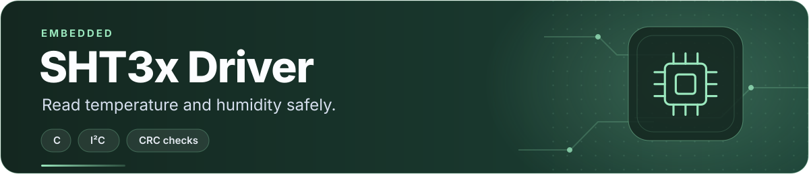

# 

A C driver for Sensirion SHT3x sensors. `readSensorChecked()` validates both CRCs and leaves the previous sample intact when a read fails. The compatibility wrapper returns NaN measurements on failure.

[](https://github.com/svazqz/sht3x/actions/workflows/ci.yml)

[Quick start](#quick-start) · [Validation](#validation) · [Project layout](#project-layout)

## Quick start

Use Git, a C11 compiler, and Make. The first build initializes the pinned `soft_i2c` submodule.

```sh
make
```

The driver archive is `build/libsht3x.a`. Build the bundled `soft_i2c` library with WiringPi installed on the Raspberry Pi. Link both archives into your app and initialize the bus with `setupI2C()`.

## Validation

The same Docker command used by GitHub Actions runs the unit tests with
sanitizers and enforces at least 95% line coverage for the production driver.

```sh
git submodule update --init
docker run --rm --network none \
  --mount "type=bind,source=$PWD,target=/src,readonly" \
  gcc:14-bookworm sh /src/tests/run-container-tests.sh sht3x
```

```sh
make test
```

The tests simulate I²C and run without connected hardware. Checks cover conversion, both checksums, acknowledgments, and bus errors.

## Project layout

| Path | Purpose |
| --- | --- |
| [`include/`](include/) | Public C interface |
| [`src/`](src/) | Driver implementation |
| [`tests/`](tests/) | Mock-bus unit tests |
| [`soft_i2c/`](soft_i2c/) | Pinned GPIO-based I²C submodule |
